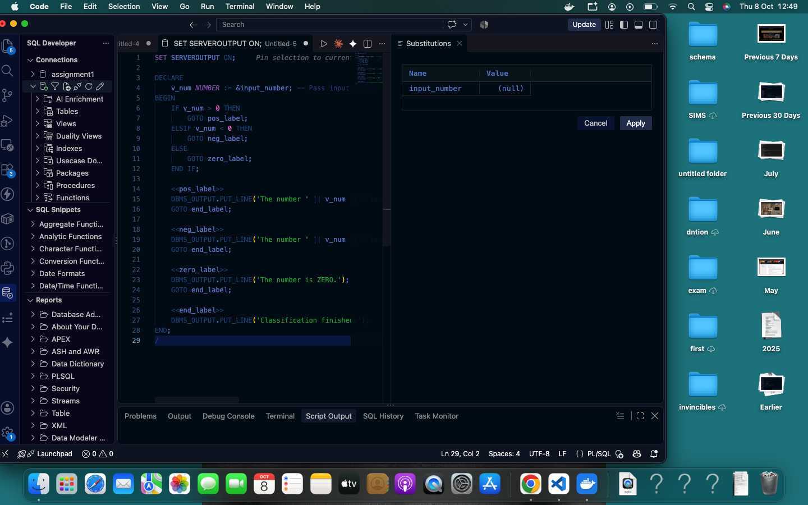
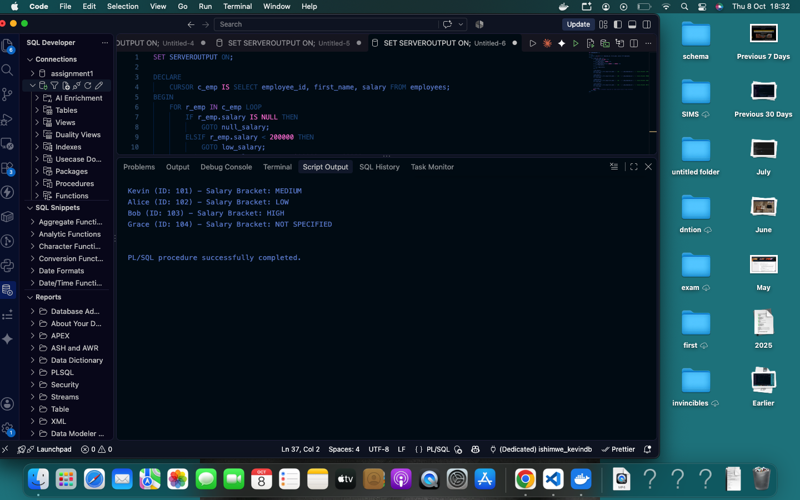
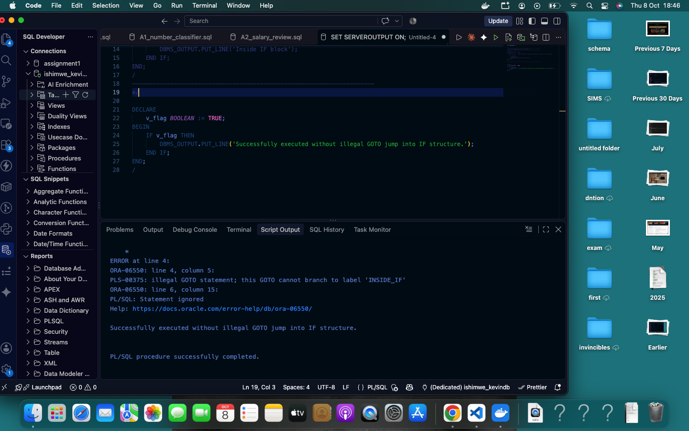
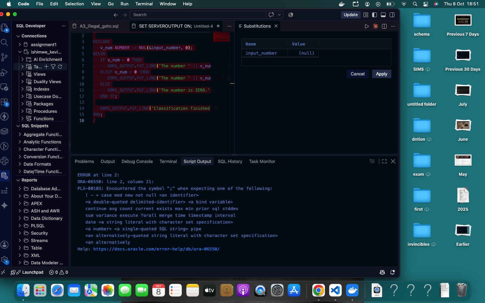
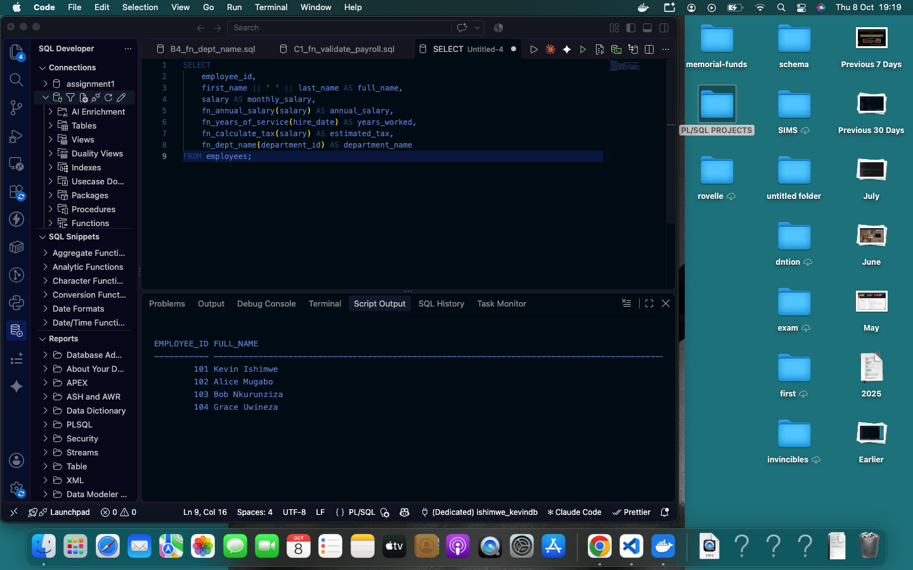
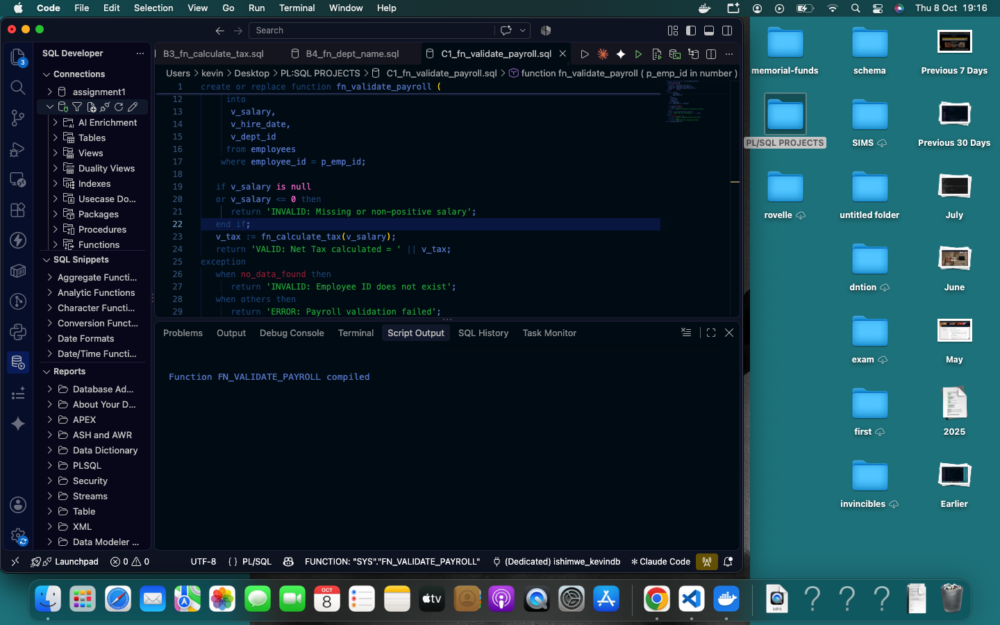

echo "# PL/SQL GOTO Statements and Functions - Individual Assignment III

**Course:** Database Development with PL/SQL (INSY 8311)  
**Instructor:** Eric Maniraguha  
**Student Name:** Ishimwe Kevin  
**Student Code:** 330601200084  

---

## 📌 Project Overview
This repository contains the complete implementation for **Individual Assignment III** in PL/SQL.

- **PL/SQL GOTO Statements:** Branching logic, restrictions, and refactoring to structured control statements.
- **Stored Functions:** Scalar return values, parameter passing, and database processing.
- **Exception Handling:** Managing NO_DATA_FOUND and runtime errors gracefully in functions.
- **Functions in SQL Queries:** Executing PL/SQL functions inside SELECT queries.
- **Combined Logic:** Comprehensive payroll validation routines.

---
## 📸 Execution Screenshots

### Task A: GOTO Statements
**A1: Number Classifier Output**

**A2: Salary Review Output**

**A3: Illegal GOTO Error & Fix**

**A4: Refactored Without GOTO**

---

### Task B & C: Functions & Payroll Validation
**B5: PL/SQL Functions in SELECT Query**

**C1: Payroll Validation Output**

## 📁 Repository Structure
\`\`\`text
plsql-goto-functions-20251SEN190-KEVIN/
├── .gitignore
├── README.md
├── 00_setup/
│   └── create_tables.sql
├── 01_goto/
│   ├── A1_number_classifier.sql
│   ├── A2_salary_review.sql
│   ├── A3_illegal_goto.sql
│   └── A4_rewrite_no_goto.sql
├── 02_functions/
│   ├── B1_fn_annual_salary.sql
│   ├── B2_fn_years_of_service.sql
│   ├── B3_fn_calculate_tax.sql
│   ├── B4_fn_dept_name.sql
│   └── C1_fn_validate_payroll.sql
├── 03_tests/
│   ├── B5_functions_in_select.sql
│   ├── test_functions.sql
│   └── test_validate_payroll.sql
├── screenshots/
│   ├── A1_output.png
│   ├── A2_output.png
│   ├── A3_error_and_fix.png
│   ├── A4_output.png
│   ├── B5_select_output.png
│   └── C1_output.png
└── docs/
    └── REFLECTION.md
    ---

\`\`\`

## 🚀 How to Run
1. Execute 00_setup/create_tables.sql to initialize database tables and sample data.
2. Compile stored functions in 02_functions/.
3. Execute GOTO scripts in 01_goto/.
4. Run validation and function test queries in 03_tests/." > README.md
